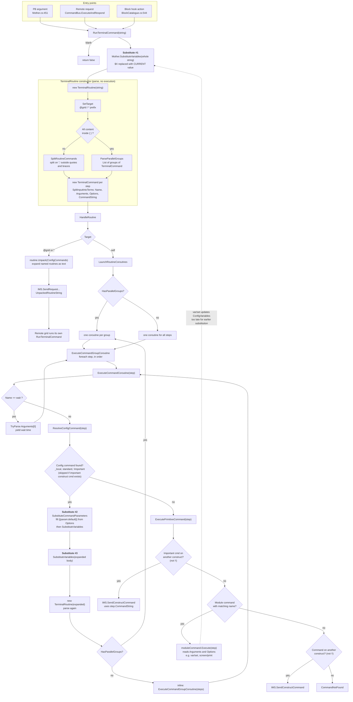

# Runtime variable substitution

Status: design decided, ready to implement (nothing implemented in Core). All open questions are resolved. See "Decisions". Progress is tracked in "Implementation plan" at the end of this file.

Last updated: 2026-10-22 20:24 (-04:00). Code verified against the working tree at 20:02. History: the "Current command path" diagram was traced at 19:37; the risks table was added at 19:55; at 20:02 the design (steps 1, 2, 3, 8), the "Complexity" section, risks 1, 3 and 6, tests and open questions were revised; at 20:10 `var/set` ordering was decided (option a); at 20:18 group independence and nested variables were decided, the failure message was specified, a blank result became a silent no-op and values holding `;` stay inlined (both after reading an advanced user's script, see "Real-world usage check"), and a "Nested variables" section was added; at 20:24 `$$`, the depth limit of 5 and the deferral of remote failure reporting were decided, and no open questions remain.

## Objective

Resolve `$VARIABLES` when each command runs, not when its routine is entered, so a variable set mid-routine (`var/set`) is seen by later steps. This applies to routines typed in the terminal and to the steps inside config commands.

## Current behaviour (verified in code)

| Point | Location | Behaviour |
|---|---|---|
| Entry | `CommandBus.RunTerminalCommand` | `Mother.SubstituteVariables` runs on the whole string before `TerminalRoutine` parses it. |
| Config command lookup | `CommandBus.ResolveConfigCommand` | `Mother.SubstituteCommandParameters` fills `{{param:default}}`, then **also** calls `SubstituteVariables` on the whole template. |
| Config command expansion | `ExecuteCommandCoroutine` | `Mother.SubstituteVariables(configCommandValue)` runs again on the whole expanded body before it is parsed. |
| Set | `SetVariableCommand` (`var/set NAME value [--save]`) | Calls `Configuration.SetVariable`, which writes `Mother.ConfigVariables` in memory and optionally persists. |
| Execution | `ExecutePrimitiveCommand` | Module commands read `command.Arguments` and `command.Options`. Delegation to other constructs and logging use `command.CommandString`. |

Failing cases:

1. `var/set X 5; wait 2; screen/print LCD $X`. `$X` is replaced at entry, before `var/set` runs.
2. A config command `Show = var/set X 5; screen/print LCD $X`. `$X` is replaced when `Show` is expanded, before its first step runs. The earlier claim that config commands are "already lazy" is true only between config commands, not between the steps inside one.

Note on case 1: the entry pass only replaces variables that are defined at that moment. If `X` is undefined, `$X` survives as literal text. If `X` is already defined (the common case, e.g. `MENU_SCREEN` in `[variables]`), the stale value is baked in and no later pass can fix it.

`Mother.SubstituteVariables` sorts all variables by key length (`OrderByDescending`) on every call, so it allocates each time.

### Current command path

Diagram as of 2026-10-22 19:37 (-04:00), traced from the code, not from a run.



Reading the diagram:

- **Substitute #1** is failing case 1. It runs on the whole string before any step has run.
- **Substitutes #2 and #3** are failing case 2, inside a config command body.
- The Parse subgraph is pure text parsing and needs no variable values, which is why per-step substitution can move after it with no parser changes.
- Remote targets are never executed locally, so they only get substitution #1, at entry.

## Proposal: substitute per step, on the command string

Substitute at the command level, as proposed: each step is resolved immediately before it executes, after all earlier steps have finished. `TerminalRoutine` already holds one `TerminalCommand` per step and the coroutine runs them in order, so no routine rework is needed.

Substitution is done on the step's `CommandString` and the step is then re-parsed, rather than patching `Arguments` and `Options` after parsing.

## Options considered

| | Approach | Verdict |
|---|---|---|
| A | Keep the entry pass. Substitute `Arguments` and `Options` values before `ExecutePrimitiveCommand`. | Rejected. Does not fix the failing case when the variable is already defined (entry pass wins). `CommandString` stays stale. |
| B | A, and remove the entry pass. | Rejected. Fixes the case, but `Name` and the `wait` argument are consumed before or outside the patch point, so `$X` as a command name or wait time stops working. `CommandString` stays stale, so delegation to other constructs, logging and the `Executing` print would show or send raw `$X`. |
| C | Split on `;` first, then substitute and parse each step when it runs. | `TerminalRoutine` already splits and parses without needing variable values, so this is effectively D with no extra rework. |
| D | Remove the entry pass for local routines. At the start of `ExecuteCommandCoroutine`, substitute `command.CommandString` and re-parse into a new `TerminalCommand`. Remove the eager passes in config lookup and expansion. | **Recommended.** |

D keeps today's string-level semantics exactly (quoting, a value with spaces unquoted becomes several terms, `$X` works as name, `wait` time, option value), only moved to the moment of execution.

## Design (option D)

1. **Fast path.** `Mother.SubstituteVariables` returns the input when there are no variables or `input.IndexOf('$') < 0`. This is the common case and costs one scan of a short string.
2. **Prefix index instead of sort-and-replace.** Replace the current "sort all variables, then `Replace` each one" with a single scan of the input:
   - At each `$`, if the next character is also `$`, append a single `$` and skip both (the escape, decision 5). Otherwise find the longest variable name that matches the text after it, and append that variable's value. Text with no match is copied unchanged. This is the same longest-name-wins rule as today.
   - Candidate names come from a cached index: `Dictionary<char, string[]>` keyed by first character, each array sorted longest-first. A lookup compares only the names that share the first character (a handful of 200), with no allocation per name.
   - The index holds **names only**. Values are read live from `ConfigVariables`, so `var/set` on an existing name needs no invalidation. Only a change to the set of names does.
   - `ConfigVariables` is a public dictionary written directly (`LoadVariables` clears and sets; `SetVariable` sets), so invalidate explicitly in `LoadVariables` and when `SetVariable` adds a new name. As a backstop, store the dictionary `Count` with the index and rebuild when it differs.
   - Values are expanded recursively, up to a fixed depth (see "Nested variables").
3. **Step resolution.** Add a resolve step to `CommandBus` that runs first in `ExecuteCommandCoroutine`, before the `wait` check and `ResolveConfigCommand`, so name, wait time, options and `CommandString` are all current:
   - If `CommandString` has no `$`, use the same `TerminalCommand` instance.
   - Otherwise substitute.
   - **Blank result: silent no-op.** The step is skipped, nothing is printed, and the routine continues. An empty variable is a normal way to turn a step off (see "Real-world usage check"), and today an empty result produces no step, so this is unchanged.
   - **Result with `;` or `{`:** parse it with `TerminalRoutine`, the code that parsed the original, and run the resulting steps in place of the step, inlined exactly as an expanded config command is (parallel groups launch as separate coroutines). This keeps today's behaviour for a variable that holds several steps (`X="a; b"`), and `;` inside quotes still does not split. The inlined steps are not resolved a second time, so nothing loops. If the parsed result has a remote target (`@grid`), the step fails: a variable cannot redirect a step to another grid.
   - **Otherwise** `new TerminalCommand(substituted)`.
   - Failures (parse exception such as a duplicate option, a remote target in a value, nesting too deep) go to design step 8.
4. **Entry.** `RunTerminalCommand` no longer calls `SubstituteVariables`.
5. **Config commands.**
   - Add an optional `bool substituteVariables = true` parameter to `Mother.SubstituteCommandParameters`. `ResolveConfigCommand` passes `false`. The default keeps MotherOS `autolcd/print` behaviour unchanged.
   - Remove `Mother.SubstituteVariables(configCommandValue)` from `ExecuteCommandCoroutine`. Steps of the expanded body are resolved by step 3 as they run.
   - `{{player:$PLAYER}}` still works: the default is inserted as text and resolved when the step runs.
6. **Remote routines** (`@target ...`, `@* ...`). These are not executed locally, so there is no later moment to substitute. In `RunTerminalCommand`, parse the raw string first; if `routine.Target` is not `self`, rebuild the routine from `SubstituteVariables(commandString)` and continue as today. This reproduces today's behaviour exactly:
   - The sender's variables are applied to the typed text only. Config command bodies expanded by `Unpack` still carry raw `$VAR`, which the remote resolves with its own variables. Substituting `UnpackedRoutineString` instead would change that, so do not.
   - `@$TARGET` keeps working, because the first parse already sees a leading `@` and the rebuild resolves the target name.
7. Do not change `TerminalRoutine` parsing or parallel group handling.
8. **Failure handling.** A failed step stops its routine and prints a clear message to the terminal. Parallel groups stay independent (decision 3): a failure never stops a sibling group.
   - **What fails:** a parse exception after substitution (duplicate option, malformed term), a remote target inside a value, or variable nesting deeper than the limit. A blank result is not a failure (step 3).
   - **What stops:** the coroutine that was running the step, which includes any config command inlined into it. Inlined config commands run inside the caller's coroutine, so a failure inside one stops the whole chain above it. Steps still to run in that coroutine are discarded. Steps already run are not undone.
   - **Message.** Printed once with `Mother.Print` and written with `Log.Info`, from a new entry in `CommandBus.Messages`. It must answer: which routine, where, what, why, and what is unaffected.

     ```
     Routine stopped: group 2 of 3, step 4 of 6 (Recharge > ZGDGUIWorking)
       Step:     screen/print "$LCD" "$MSG" --level=$LVL --level=high
       Resolved: screen/print "Cockpit" "Hello" --level=low --level=high
       Reason:   duplicate option --level
       Not run:  2 later steps in this group
       Other groups are not affected and keep running.
     ```

     Rules:
     - The location line always gives the step position (`step 4 of 6`) and, for a parallel launch, the group (`group 2 of 3`). A single sequential routine omits the group.
     - The chain in brackets lists config commands entered, outermost first, so a failure inside a config command names it. Omitted at top level.
     - `Step` is the text as written, with `$VAR` unresolved. `Resolved` is shown only when substitution succeeded, and is omitted when the failure was in substitution itself. Both are needed: the resolved text may be blank or surprising, and the written text is what the author edits.
     - `Reason` is a short sentence naming the cause. For nesting, it names the chain, for example `variable nesting deeper than 5: A > B > A > B > A`.
     - `Not run` counts the remaining steps in that coroutine, including those of enclosing config commands.
     - The last line appears only for a parallel launch, and states the independence guarantee so that the author does not assume the other groups stopped.
   - **Mechanism.** `ExecuteCommandCoroutine` cannot return a value through `IEnumerable<double>`, so pass a small `RoutineState` object down from `LaunchRoutineCoroutines` through `ExecuteCommandGroupCoroutine` and `ExecuteCommandCoroutine`. It holds `Failed`, the group index and count, and a short list of config command names entered (pushed on inline, popped on return). The failing step sets `Failed` and does `yield break`. Each enclosing loop checks `Failed` after every step and also does `yield break`. The Clock runs one coroutine to its next `yield` without interleaving, so the flag is set and read in the same `MoveNext` call and needs no locking. Each group gets its own `RoutineState`, which is what keeps groups independent.
   - **Scope.** Failures introduced by this change. `Command not found` and exceptions thrown inside a module's `Execute` keep their current behaviour. A remote routine fails on the remote grid and prints to that grid's terminal; returning the message to the sender is out of scope.

### Example

```ini
[autolcd]
Recharge=
| battery/charge "$BATTERIES";
| view/notify "$MENU_SCREEN" "Batteries recharging." --level=success;
```

Unchanged result when no variable changes between steps. If an earlier step runs `var/set MENU_SCREEN "Cockpit:2"`, the `view/notify` step uses the new value, even when `MENU_SCREEN` was already defined in `[variables]`.

## Behaviour changes to accept

- A step that fails to parse after substitution, or whose value nests too deeply, stops its routine with a printed message instead of throwing out of the Clock.
- Nested variables are now defined and supported (`A="$B"` expands B). Today the result depends on name lengths: a value containing `$SHORT` is expanded by a later, shorter name, but one containing `$LONGER` is not.
- `$$` becomes a literal `$` (decision 5). Today `$$X` yields `$` followed by X's value.
- A routine now sees variable changes made by **other** routines while it is waiting (see risk 4). Previously its text was frozen at entry.

Unchanged, and covered by tests: a blank result is a silent no-op, a value holding `a; b` still runs as two steps, and an undefined variable stays literal.

## Real-world usage check

An advanced user's custom data (shared 2026-10-22; about 57 variables, about 60 custom commands, many menu items) was read against this design. It shows the patterns the design must keep working, and that the problem in this spec is already being worked around by hand.

| Pattern in the script | Example | What the design must do |
|---|---|---|
| **Variable holds a command name** | `[variables] MenuResetMaybe=MenuResetYes`, then `[commands] MenuResetMaybe=$MenuResetMaybe;`, switched by `var/set MenuResetMaybe "MenuResetNo" --save` | `$X` resolved as the **command name** of a step, then looked up as a config command. This is why option B (patching `Arguments` and `Options` after parsing) is rejected: it would break this script. |
| **Empty variable switches a step off** | `ZGDTutorialPageNext=` (empty) with `ZGDTutorialPageNext=$ZGDTutorialPageNext;`; about 40 `...Onboard`/`...Offload` variables that are empty until set | A blank result is a **silent no-op**, not a failure. An earlier draft of this spec stopped the routine on a blank step, which would have broken this script. |
| **Names that are prefixes of other names** | `ZGDTutorialPageNext` and `ZGDTutorialPageNextProxy` are both variables | Longest name wins at each `$`. A test uses these real names. |
| **`var/set` then use** | A file comment: "LCDBack requires that toolbar command view/select is followed by var/set ZGDLCDBack"; `Allow=` menu items run `var/set ZGDOreCobaltOnboard "Cobalt" --save` then `ZGDLCDSorterOnboard`, whose body prints `$ZGDOreCobaltOnboard` | This is the failing case of this spec. The author keeps the `$VAR` references inside a separate config command so they are expanded after the `var/set`, and uses `X=$X;` indirection for the same reason. That workaround must keep working, and it will, because config bodies are resolved step by step. Authors no longer need it. |
| **New names created at run time** | `var/set ZGDOreGoldOnboad "Gold"` (a typo, so a new variable), `var/set ZGDPlatinumOnboard` | The prefix index must pick up names added by `var/set` after boot (risk 2). A typo silently makes a new variable, as today. |
| **Undefined variable in text** | `$ZGDOreSilconOnboard` printed on an LCD, but never defined | Stays literal, as today. |
| **Many `--save` writes** | Nearly every menu item | Unchanged. `--save` stores the raw value (relevant to nested variables). |

The script does not use nested variables or `{{param}}` defaults. Nested support is therefore for new use, and must not change anything above.

## Nested variables

Goal: a variable's value may refer to other variables (`[variables] Greeting="Hello $PLAYER"`), resolved when used.

**Approach: recursive expansion inside the single scan.** No extra pass over the string.

1. At a `$`, find the longest matching name (design step 2) and read its value.
2. If the value has no `$` (`IndexOf('$') < 0`, checked live on a short string), append it directly. This is the common case and adds no cost.
3. Otherwise scan the value the same way, one level deeper, and append the result.
4. Stop at a fixed depth (`MaxVariableDepth` = 5, decision 6). At the limit, leave the `$NAME` text unexpanded and report an error naming the chain of names. The chain is recorded in a small fixed array, written only when nesting occurs.
5. Only values are re-scanned. Text already in the output, such as a literal `$5` in a step, is never re-scanned.

**Late binding.** Resolution happens when the outer reference is resolved, at step run time, so `var/set B 2` followed by a step using `$A` (`A="$B"`) sees `2`. `--save` and `[variables]` store the raw text, so the reference survives a reboot.

**Why this is efficient**

- Cost is proportional to the size of the expanded output plus one `IndexOf` per value. It does not depend on the number of variables, and non-nested values cost nothing extra.
- No cache of expanded values and no invalidation, so no stale-value risk (risk 2 is unchanged). A cached "fully resolved" value would need invalidating whenever any variable it depends on changes.
- A cycle (`A="$B"`, `B="$A"`) ends at the depth limit after 5 expansions. A fan-out of 2 references per value costs at most 2^5 = 32 expansions before the limit. Both are small and bounded, which matters under the instruction limit.

**Rejected alternatives**

| Approach | Why not |
|---|---|
| Flatten all variables when they change | `O(V)` or worse on every `var/set`, and it freezes the value, so late binding is lost. |
| Repeat full-string `Replace` until nothing changes | Cost `O(passes x V x L)`, never ends on a cycle without a cap, and re-scans literal `$` text that was already inserted. |
| Memoise expanded values | Needs dependency tracking to invalidate. More code and more instructions than re-scanning short values. |

**Where it applies.** `Mother.SubstituteVariables` is shared. The bus path needs to report a failure (nesting too deep) and stop the routine. Other callers, such as MotherOS `autolcd/print`, only need text. So add `bool TrySubstituteVariables(string input, out string result, out string error)` for the bus, and keep `SubstituteVariables(string)` as a wrapper that ignores the error and leaves the `$NAME` text in place. `autolcd/print` gets nested variables with no change.

**Storing a reference with `var/set`.** `var/set A "$B"` resolves `$B` first (the step is resolved before it runs), so `A` receives B's current value, not a reference. To store a reference, use the escape `$$` (decision 5): `var/set A "$$B"` stores `$B`.

**Escape.** At a `$`, if the next character is also `$`, the scan appends one `$` and moves past both, with no name lookup. The escape is handled at every nesting level, so a stored `$$5` is read as the literal `$5`.

## Complexity

Scenario: **200 variables, 100 custom commands in use, 10 steps each (1,000 steps)**. Assumptions: a routine body is about 400 characters and a step about 40; 3 of every 10 steps reference a variable, with 1.5 references each; steps are primitives (no nested config commands). Counts below come from reading the code, **not from measurement**. Confirm with `Runtime.CurrentInstructionCount` before and after (see Tests).

`V` = variables, `L` = length of the string being substituted.

| | Where the work happens | Cost per call |
|---|---|---|
| Today | `SubstituteVariables` sorts all `V` variables, then calls `Replace` once per variable (each builds `"$"+key` and scans the whole string) | `O(V log V)` sort + `V` string allocations + `O(V x L)` characters scanned, **every call, whether or not the string has a `$`** |
| Per-step, naive | Same function, called per step instead of on the whole routine | Same cost per call, but ~11 calls per routine instead of 3 |
| Proposed | Fast path, then a single scan with a prefix index | `O(L)` for the `$` check. Steps with `$`: `O(L + r x c)`, where `r` = references in the step and `c` = names sharing a first character (about 8 of 200). No sort, no per-name allocation. |

**One command invoked (10 steps):**

| | Calls to `SubstituteVariables` | Sorts of 200 | `Replace` calls and `"$"+key` allocations | Characters scanned or compared |
|---|---|---|---|---|
| Today (entry, lookup, expansion) | 3 | 3 | 600 | ~163,000 |
| Per-step, naive | 11 | 11 | 2,200 | ~83,000 |
| **Proposed** | 11 (8 return at the `$` check) | 0 | 0 | ~440 for the `$` checks + ~40 for 3 steps with variables |

**All 100 commands invoked:**

| | Sorts of 200 | `Replace` calls and allocations | Characters scanned or compared |
|---|---|---|---|
| Today | 300 | 60,000 | ~16.3 million |
| Per-step, naive | 1,100 | 220,000 | ~8.3 million |
| **Proposed** | 0 | 0 | ~50,000 |

What this shows:

- **Per-step substitution on its own is worse than today.** It cuts characters scanned but multiplies sorts and `Replace` calls by 3.7 (1,100 vs 300 sorts, 220,000 vs 60,000 calls). This is why the fast path and the prefix index are required parts of the design, not optimisations to add later.
- **Proposed cost no longer depends on `V`.** Doubling variables to 400 doubles today's cost per call (more `Replace` calls) but leaves the proposed cost unchanged, apart from slightly more names per first character. Cost depends on how many `$` references run, not how many variables exist.
- **Cost is spread across ticks.** Today the full substitution of a whole routine happens in one tick, at entry. If one command starts several others, those spikes land in the same tick. The proposed work happens one step per coroutine per Clock run (each primitive step yields), so a burst of 100 routines becomes about 100 `IndexOf` checks per run plus a few matches, not 100 full substitutions at once.
- **Allocations drop to the result strings.** Today each call allocates about 200 temporary `"$"+key` strings and sort buffers. The proposed path allocates one result string (and one `TerminalCommand`) per step that contains `$`, and nothing for steps that do not.
- **Memory:** the prefix index holds 200 name references and is rebuilt only when names change (at load, or when `var/set` adds a new name). Rebuilding sorts 200 names once.
- **Nested variables:** a value containing `$` costs one extra scan of that value per level, up to 5 levels. Values without `$` cost one `IndexOf`. Not in the tables above because the scenario assumes flat values.

Residual cost: a step with `$` is re-parsed (`SplitInputIntoTerms` over about 40 characters) once, where today it is parsed once at entry. A 100-step burst with 30 `$` steps is about 30 extra small parses spread over several ticks.

## Risks

| # | Risk | Why it matters | Mitigation | Residual |
|---|---|---|---|---|
| 1 | **Performance** (instruction limit) | Every step now runs `SubstituteVariables`, and a step containing `$` is re-parsed. The current code sorts and allocates on every call. | Fast path (`IndexOf('$') < 0` returns the input, and the same `TerminalCommand` instance is reused). Single-scan substitution with a cached prefix index replaces sort-and-`Replace`, so cost no longer scales with the number of variables. Entry and config-lookup/expansion passes are removed. See "Complexity" for the 200-variable, 100-command scenario. | Steps with `$` pay one re-parse each. Verify the numbers in "Complexity" by measuring instruction count before and after. |
| 2 | **Stale cache** | A cached name list that misses a newly added variable would leave `$NEW` unresolved. | Cache names only and read values live (value updates never go stale). Invalidate in `LoadVariables` and on new names in `SetVariable`. `Count` comparison as a backstop. Tests for `var/set` of a new name and for a config reload. | Direct writes to the public `ConfigVariables` that replace names without changing `Count`. Only `Configuration` writes it today. |
| 3 | **Double substitution and loops** | A value containing `$OTHER` could be expanded more than once, or forever. | Each step is substituted once. Entry, lookup and expansion passes are removed (today there are three). Expansion happens only inside the scan, by recursion on values, so literal text is never re-scanned. A depth limit (5) stops cycles such as `A="$B"`, `B="$A"` and bounds fan-out. A config command called with `--opt=$X` is resolved at the invoking step, so its expanded body only re-resolves it if the value itself contains `$NAME`. Steps inlined from a variable's value are not resolved again. | A cycle is a step failure with a message naming the chain (design step 8). Cost of the limit: at most 2^5 expansions for a fan-out of 2. |
| 4 | **Visibility across routines and groups** | Groups and separate routines run as separate coroutines. A `var/set` in one is now seen by the others from that moment, including routines already part-way through a `wait`. Today each routine's text is frozen at entry. The order of a `var/set` relative to a use in another group is not defined. | This is the intended meaning of "resolve when the command runs". The ordering is deliberately undefined (decision 2): documented in the user docs and the CHANGELOG, with a test pinning today's `Clock` order so a change is noticed. Use a single sequential routine, or `wait`, when order matters. | Long routines can pick up changes made elsewhere. If a snapshot is ever needed, add an explicit opt-in rather than reintroducing entry substitution. |
| 5 | **Remote routines** | There is no local later moment to resolve. A naive fix (substituting after `Unpack`) would also resolve config command bodies with the sender's variables, which today the remote resolves with its own. | Rebuild a remote routine from the substituted typed text (design step 6). Sender and remote behaviour is identical to today, including `@$TARGET`. Test a remote send. | None known. |
| 6 | **Exceptions mid-coroutine** | Re-parsing happens while the coroutine runs. A variable that injects a duplicate option (`--a=1 --a=2`, which `Options.Add` rejects) or a remote target would throw inside the Clock and could stop the script. Today the same failure happens once at entry. | Parse exceptions are caught when the step is resolved. The failed step prints the message in design step 8 and stops its routine. The exception never reaches the Clock. A blank result is a no-op, not an error. | A routine can stop half done, with earlier steps already run. The message says how many steps did not run. |
| 7 | **Config command regressions** | Removing the eager passes could leave `$VAR` or `{{p:$VAR}}` defaults unresolved, or change `autolcd/print` output. | `SubstituteCommandParameters` keeps variable substitution by default (`substituteVariables = true`). Only `ResolveConfigCommand` opts out, and the step that receives the expanded text resolves it. Existing `{{player:$PLAYER}}` and `autolcd/print` tests must pass unchanged. | None known. |
| 8 | **Behaviour changes** | See "Behaviour changes to accept". Values holding `;` or `{}` keep working as today (inlined), so the remaining changes are `$$` and defined nested expansion. | Noted so each change is a decision, not a surprise. Tests pin the new behaviour. | A config that contains a literal `$$`. Unlikely. |

Resolved commands are what get logged and delegated, so `Mother.Print("> " + commandString)` and `IMS.SendConstructCommand` show the same text as before.

## Tests (to write, in `tests/MotherCore.Tests/Tests/Module`)

`CommandBusTests` and `ConfigurationTests` already cover variables, so add there.

- Set then use in one routine, with the variable **already defined** (the regression this spec exists for).
- Set then use in one routine, with the variable undefined beforehand.
- Set then use inside the body of one config command.
- A quoted value with spaces stays one argument.
- An undefined variable stays literal.
- A variable inside an option value (`--level=$LEVEL`).
- `$X` as a `wait` duration and as a command name.
- A config command with `{{p:$VAR}}` default, and with a `--p` override.
- A parallel group containing a variable.
- A remote routine (`@grid ...`) is sent with variables resolved in the typed text, and with config command bodies left raw.
- `@$TARGET cmd` still targets the resolved grid.
- A `var/set` in one routine is seen by another routine that is waiting.
- Pins `Clock` order: with `{ var/set X 1; log A } { log $X }` and `X` previously `0`, `log $X` sees `0` (the later-written group runs first within a `Run`). Comment that this documents current scheduling and is not a guarantee.
- A variable producing duplicate options stops the routine and prints the message in design step 8 (location, written step, resolved step, reason, count not run). Later steps do not run.
- A new variable added by `var/set` after the cache was built is resolved (cache invalidation on new names).
- A value containing `a; b` runs as two steps, as today. A `;` inside quotes does not split. A value containing a parallel group launches the groups.
- A value that resolves to a remote target (`@grid cmd`) fails with a clear message.
- A step that resolves to empty is a silent no-op: nothing is printed and the next step runs.
- The "Maybe" pattern from the real script: `[variables] X=Yes`, `[commands] Maybe=$X;`, `Yes=<cmd>`, `No=` (empty). `Maybe` runs `<cmd>` when `X=Yes`, does nothing when `X=No`, and switches after `var/set X No`. Also `Next=$Empty;` with an empty variable is a no-op.
- The failure message: shows `group 2 of 3` and `step 4 of 6`, names the config command chain, shows the written and resolved step, states the reason, counts the steps not run, and (for a parallel launch) states that other groups are not affected. A single sequential routine omits the group and the last line.
- A failure inside an inlined config command stops the calling routine, not just the config command.
- A failure in one parallel group does not stop a sibling group, and that sibling still completes all its steps.
- Longest name wins at a `$` (`$PLAYER_NAME` vs `$PLAYER`, and the real names `$ZGDTutorialPageNextProxy` vs `$ZGDTutorialPageNext`), and `$` followed by no known name stays literal.
- Nested: `A="$B"`, `B=x` yields `x`. Three levels deep resolves. Nested inside a quoted argument stays one argument.
- Late binding: `A="$B"`, then `var/set B 2`, then a step using `$A` sees `2`.
- Cycle (`A="$B"`, `B="$A"`) fails at the depth limit with a message naming the chain `A > B > A > B > A`. A fan-out cycle (`A="$B$B"`, `B="$A$A"`) also ends at the limit, in a bounded number of expansions.
- Self-reference (`X="$X"`) fails at the depth limit and does not loop.
- `--save` of a value containing `$B` writes the raw text to CustomData, and it is still a reference after a reload.
- `$$` yields a literal `$`, and `var/set A "$$B"` stores `$B` so that a later `$A` resolves B. `$$X` with X defined yields the text `$X`, not X's value. A stored `$$5` reads as `$5`.
- A literal `$5` in a step is not treated as a variable and is not re-scanned.
- `MotherOS autolcd/print` resolves nested variables in view text through the `SubstituteVariables` wrapper, and a too-deep value leaves the `$NAME` text.
- Prefix index: 200 variables resolve correctly, with names sharing a first character.
- Instruction count (if the harness exposes `Runtime.CurrentInstructionCount`, otherwise measure in game): 200 variables, 100 commands of 10 steps, before and after. Record the entry-tick total and the maximum per-tick total. Acceptance: both are lower than today's.
- A no-`$` string is returned unchanged (fast path) and the same `TerminalCommand` instance is reused.
- The cache is invalidated after `var/set` and after a config reload.
- Existing tests (`It_Substitutes_Variables_In_Terminal_Input`, `SubstituteCommandParameters` tests) still pass.

## Related work

MotherOS `autolcd/print` already substitutes `$VAR` and `{{param:default}}` in view text at print time, using `Mother.SubstituteCommandParameters` with the default flag. It benefits from the fast path with no further change. See `MotherOS/specs/autolcd-module.md`.

## Decisions

1. **A failed step stops its routine and prints to the terminal** (design step 8).
2. **`var/set` ordering across routines and groups is undefined (option a), decided 2026-10-22 20:10 (-04:00).** Nothing in Core enforces or promises an order between coroutines. Consequences:
   - No change to `Clock`, `TerminalRoutine` parsing or group launching.
   - Document the rule in the user-facing docs: within one sequential routine, a `var/set` is visible to every later step. Across parallel groups or separate routines, do not rely on order. Put dependent steps in one sequence, or separate them with `wait`.
   - Add one test that pins today's scheduling order (the last-written group runs first within a `Run`), with a comment that the order is an implementation detail and not a guarantee. If `Clock` changes, the test fails and prompts a deliberate decision rather than a silent change.
   - Add a CHANGELOG entry under the release that ships this change: variables are resolved when each command runs, and ordering across groups is not guaranteed.
   - Revisit a barrier (option c below) only if users need cross-group synchronisation.
3. **Parallel groups stay independent on failure, decided 2026-10-22 20:18 (-04:00).** A failed step stops only its own group. Sibling groups keep running and complete. Parallel groups exist so that routines do not interfere with each other, so one group's failure must not cancel another. The cost is that hardware can be left in a mixed state (one door open, one not), so the failure message must be unambiguous about what stopped and what did not. See design step 8 for the format. The message states that other groups are not affected.
4. **Nested variables are supported, decided 2026-10-22 20:18 (-04:00).** Values may refer to other variables, resolved recursively in the single scan, to a fixed depth, with late binding. See "Nested variables".
5. **`$$` is a literal `$`, decided 2026-10-22 20:24 (-04:00).** The scan yields a single `$` for `$$` without a name lookup, so `var/set A "$$B"` stores the reference `$B`. Cost: one extra comparison at each `$`. `$$X` changes meaning (today it is `$` followed by X's value). Nothing in the real script reviewed uses `$$`. Document it in the user docs and CHANGELOG.
6. **Nesting depth limit is 5, decided 2026-10-22 20:24 (-04:00).** A named constant (`MaxVariableDepth`). Worst-case fan-out for two references per value is 2^5 = 32 expansions. Raise only if a real config needs more.

### Deferred

- **Showing a failure on the sending grid for remote routines**, decided 2026-10-22 20:24 (-04:00). A remote routine that fails prints on the remote grid only. Reporting it back needs a second, later message, because the `COMMAND_EXECUTED` response is sent before the first step runs. Captured as a separate idea in [remote-routine-failure-reporting.md](./remote-routine-failure-reporting.md). Design step 8 carries the data it needs (group, step, chain, written step, reason) in `RoutineState`, so no rework is needed later.
- **Removing the need to quote variables that contain spaces**, noted 2026-10-22 20:39 (-04:00), to revisit in a future iteration. This change keeps today's string-level substitution, so `COCKPIT="Cockpit [LCD]"` must still be written `block/on "$COCKPIT"`. The quotes in the `.ini` value only delimit the value and are not carried into the command text. An unquoted `$COCKPIT` becomes several terms. Possible approach: an opt-in syntax such as `${COCKPIT}` that always expands to one argument, leaving `$NAME` as it is so that a variable holding several terms or steps (`X="a; b"`) still works. Open points for that iteration: how it interacts with a value that already contains quotes, and with `$` as a command name or `wait` time.
### Why the order is undefined

The scheduling facts, verified in [Clock.cs](/c:/Users/nun_o/source/repos/Mother/MotherCore/src/Modules/Clock/Clock.cs):

- `Clock.Run` walks the coroutine list **from last added to first** (`for i = Count - 1 .. 0`).
- Each coroutine advances **one step per `Run`**: every primitive step ends with `yield return 0`, and the next step runs on the next `Run`.
- `RunTerminalCommand` only adds coroutines. The first step runs on the next `Run`, not synchronously.
- A `wait N` sets the coroutine's timer to `N` seconds, which is reduced by the real time between runs. A wait therefore resumes on the first `Run` at or after `N` seconds, so its exact tick can vary with the update frequency.

Today ordering does not matter, because each routine's text is frozen at entry and nothing is shared. With per-step resolution the variables are shared mutable state, so it does.

Example: `{ var/set X 1; log A } { log $X }`, with `X` previously `0`. Groups are launched in written order, so the second group is later in the list and runs first in each `Run`:

| Run | Group 2 (`log $X`) | Group 1 (`var/set X 1; log A`) |
|---|---|---|
| 1 | `log $X` resolves X = `0` | `var/set X 1` |
| 2 | (finished) | `log A` |

If the groups were written the other way round, group 2 would be the `var/set` group and `log $X` would see `1`. So **the result depends on which group is written last**, which is an accident of the list order, not something the author wrote down. Waits add a second source of variation (tick alignment).

Options considered:

| | Approach | Verdict |
|---|---|---|
| a | Leave undefined. Document: do not rely on order across groups. | **Chosen.** No cost. |
| b | Launch groups in reverse so that written order matches run order. | Rejected. Hidden coupling to `Clock`'s iteration order, and `Clock` is shared by every module. |
| c | A barrier: groups start together and a `sync` step waits for all. | Deferred. New command and shared state across coroutines, larger than this change. |
| d | Snapshot variables per group at launch. | Rejected. Brings back the stale-value problem inside each group. |

## Open questions

None. Deferred work is listed under "Deferred" in the Decisions section.

## Implementation plan

Added 2026-10-22 21:05 (-04:00), after re-reading this spec against the working tree. Tick a box (`[x]`) when the action is done and its tests pass. Update the status table in the same commit.

### Status

| Phase | Scope | Status |
|---|---|---|
| 0 | Baseline and review notes | Not started |
| 1 | Substitution engine in `Mother` | Not started |
| 2 | Per-step resolution in `CommandBus` | Not started |
| 3 | Failure handling (`RoutineState`, message) | Not started |
| 4 | Remaining tests and measurement | Not started |
| 5 | Documentation and release | Not started |

Phases are in order. Each ends with a green `dotnet test` and can be committed on its own. Phase 1 changes no behaviour a user can see (the engine is swapped, `$$` and nesting aside), so it is the safest to ship first.

### Review notes (code re-checked 2026-10-22)

Confirmed against the code: the entry pass at `CommandBus.RunTerminalCommand`, the lookup pass in `SubstituteCommandParameters`, the expansion pass in `ExecuteCommandCoroutine`, the `Clock.Run` reverse iteration, `AddCoroutine` from inside a coroutine, and the callers (`Mother.cs:451`, `BlockCatalogue.cs:544`, `ExecuteAndRespond`). The design holds. Points the plan has to handle that the spec does not state:

| # | Finding | How the plan handles it |
|---|---|---|
| 1 | The language level is C# 6 (`LangVersion` 6 in the test project, matching the Programmable Block). No `out var`, tuples, local functions or pattern matching. `TrySubstituteVariables(string, out string, out string)` is fine as written. | Noted on every code action. Build will fail otherwise. |
| 2 | `FakeGridProgramRuntimeInfo.CurrentInstructionCount` is a plain settable property. The harness does **not** measure instructions. | Instruction acceptance is measured in game (P4.5). In the harness, assert the proxies instead: a no-`$` step reuses the same `TerminalCommand`, and a no-`$` string is returned by reference. |
| 3 | A variable that resolves to a remote target (`@grid ...`) worked before (the entry pass ran before parsing the target) and now fails by design. It is not in "Behaviour changes to accept". | Added in P5.2 so the CHANGELOG states it. |
| 4 | When a config command expands to parallel groups, each group becomes its own coroutine. The spec says each group gets its own `RoutineState` but not whether it inherits the config command chain. | Decision: a group launched from a config command **copies the chain** so the message still names it. Group index and count are those of the new launch. P3.2. |
| 5 | "Step 4 of 6" is ambiguous when config commands are nested. | Decision: position and total are within the **innermost body being run**. The chain gives the context and `Not run` counts enclosing bodies too, as the spec says. P3.2. |
| 6 | A `--opt=$X` value is resolved at the invoking step, inserted into the config body, then resolved again as part of that step. A value that already contains `$$` is therefore unescaped twice. | Accepted (spec risk 3 already covers `$NAME`). Add one test that pins the behaviour so it is deliberate (P4.1). |
| 7 | Name matching must stay ordinal and case-sensitive, as `string.Replace` is today. | P1.2 uses `string.CompareOrdinal`, not culture compare. |
| 8 | New source files must be added to `src/MotherCore.projitems`, or the Programmable Block build will not include them. | P3.1 (only if `RoutineState` goes in a new file). |
| 9 | `Clock.Halt` disposes enumerators, which is safe with the flag approach, since `RoutineState` holds no resources. | No action. A test already covers `halt` (P4.1 re-runs it). |

### Phase 0: Baseline

- [ ] **P0.1** Run `dotnet test tests\MotherCore.Tests\MotherCore.Tests.csproj` on the untouched tree. Record the pass count. Any existing failure is noted here before work starts, so it is not blamed on this change.
- [ ] **P0.2** Record the in-game baseline for P4.5: instruction count at the entry tick and the maximum per tick, for the "200 variables, 100 commands, 10 steps" scenario (or the user's real script). Store the numbers in this spec under "Complexity".
- [ ] **P0.3** Create a branch for the work.

### Phase 1: Substitution engine (`src/Mother.cs`, `Configuration.cs`)

No change to `CommandBus` yet. Existing behaviour is preserved apart from `$$` and nested values.

- [ ] **P1.1** Add `const int MaxVariableDepth = 5` to `Mother`.
- [ ] **P1.2** Add the name index: `Dictionary<char, string[]>` keyed by first character, each array sorted longest-first, plus the `ConfigVariables.Count` it was built for. Names only, ordinal compare. Add `InvalidateVariableIndex()`.
- [ ] **P1.3** Add `bool TrySubstituteVariables(string input, out string result, out string error)`:
  - Fast path: no variables or `IndexOf('$') < 0` returns `input` (same reference).
  - Single scan: `$$` yields one `$`. Otherwise longest matching name, value read live from `ConfigVariables`. No match leaves the text.
  - Recursion on values that contain `$`, up to `MaxVariableDepth`. At the limit, leave `$NAME` and set `error` to the chain (`A > B > A > B > A`). Chain held in a small fixed array.
  - Rebuild the index when `Count` differs from the stored count.
- [ ] **P1.4** Make `SubstituteVariables(string)` a wrapper over `TrySubstituteVariables` that ignores the error.
- [ ] **P1.5** Add `bool substituteVariables = true` to `SubstituteCommandParameters`. Both exits (fast path and the end) call `SubstituteVariables` only when it is true. Existing callers and tests are unchanged.
- [ ] **P1.6** `Configuration.LoadVariables` calls `InvalidateVariableIndex()` after loading. `SetVariable` calls it only when the name is new.
- [ ] **P1.7** Update the XML docs on the three methods (longest-name rule, `$$`, nesting, depth).
- [ ] **P1.8** Tests (`MotherTests` or `ConfigurationTests`): fast path returns the same reference; longest name wins (`$PLAYER_NAME` vs `$PLAYER`, `$ZGDTutorialPageNextProxy` vs `$ZGDTutorialPageNext`); undefined stays literal; `$5` untouched; `$$` cases; nested (2 and 3 levels, late binding via `SetVariable`); cycle, fan-out cycle and self-reference end at the limit with the chain in `error`; the wrapper leaves `$NAME`; 200 variables sharing first characters; index rebuilt after `SetVariable` of a new name and after a config reload; `--save` writes the raw `$B`.
- [ ] **P1.9** `dotnet test`. All existing tests pass unchanged.

### Phase 2: Per-step resolution (`CommandBus.cs`)

Failures are handled minimally here (see P2.3) and replaced in Phase 3.

- [ ] **P2.1** Add a private resolve step used first in `ExecuteCommandCoroutine`, before the `wait` check. Outcomes: unchanged (no `$`, same instance), replaced command, inlined routine (value held `;` or `{`), blank (silent no-op), failure.
- [ ] **P2.2** Inline a routine produced by a value exactly as an expanded config command is: parallel groups via `Clock.AddCoroutine`, otherwise through the current coroutine. The inlined steps are not resolved again. A remote target in the value is a failure.
- [ ] **P2.3** Until Phase 3 lands, a failure prints the reason with `Mother.Print`, logs it, and does `yield break`. This keeps the Clock from receiving an exception.
- [ ] **P2.4** Remove the entry pass in `RunTerminalCommand`. Add the remote rebuild: parse raw; when `Target` is not `self`, rebuild from `SubstituteVariables(commandString)`.
- [ ] **P2.5** `ResolveConfigCommand` passes `substituteVariables: false` at all four call sites. Remove `Mother.SubstituteVariables(configCommandValue)` in `ExecuteCommandCoroutine`.
- [ ] **P2.6** Tests in `CommandBusTests`: set then use (variable already defined; variable undefined); set then use inside one config command body; quoted value stays one argument; option value; `$X` as `wait` time and as command name; `{{p:$VAR}}` default and `--p` override; parallel group containing a variable; remote send resolves the typed text and leaves config bodies raw; `@$TARGET`; blank step is a silent no-op; the "Maybe" pattern; a value with `a; b` runs two steps and `;` in quotes does not split; a value with a parallel group launches groups; a value with a remote target fails.
- [ ] **P2.7** `dotnet test`. `It_Substitutes_Variables_In_Terminal_Input` and the `SubstituteCommandParameters` tests pass unchanged.

### Phase 3: Failure handling

- [ ] **P3.1** Add `RoutineState` (private class inside `CommandBus`, so no new file; if it is moved to its own file, add it to `src/MotherCore.projitems`). Fields: `Failed`, group index and count, and a list of config command names (chain). C# 6 only.
- [ ] **P3.2** Thread it through `LaunchRoutineCoroutines`, `ExecuteCommandGroupCoroutine` (loop by index so it knows `step n of m`) and `ExecuteCommandCoroutine`. Push the config name on inline, pop on return. Groups launched from a config body get a new state that **copies the chain** (review note 4). Position and total are for the innermost body (review note 5).
- [ ] **P3.3** On failure set `Failed`, print and log once, `yield break`. Every enclosing loop checks `Failed` after each step and also does `yield break`. A sibling group has its own state and is untouched.
- [ ] **P3.4** Add the message to `CommandBus.Messages` and format it with `MessageFormatter`. Lines: `Routine stopped: ...`, `Step`, `Resolved` (only when substitution succeeded), `Reason`, `Not run`, and the independence line only for a parallel launch. A single sequential routine omits the group and the last line.
- [ ] **P3.5** Replace the interim handling from P2.3.
- [ ] **P3.6** Tests: the message for a duplicate option (location, chain, written step, resolved step, reason, count not run); a failure inside an inlined config command stops the caller; a failure in one parallel group does not stop a sibling, which completes; a sequential routine omits the group line; nesting failure names the chain; the failure is not thrown out of `Clock.Run`.
- [ ] **P3.7** `dotnet test`.

### Phase 4: Remaining tests and measurement

- [ ] **P4.1** Tests not yet covered: a `var/set` in one routine seen by another that is waiting; the `Clock` order pin `{ var/set X 1; log A } { log $X }` with the comment that it documents current scheduling; the `--opt=$X` plus `$$` double-resolution pin (review note 6); `halt` still works.
- [ ] **P4.2** A no-`$` step reuses the same `TerminalCommand` instance (proxy for the fast path, since the harness cannot count instructions, review note 2).
- [ ] **P4.3** `MotherOS autolcd/print` check: build or run the MotherOS tests against this Core, if available, to confirm nested values and the wrapper.
- [ ] **P4.4** Full `dotnet test`. Compare the pass count with P0.1.
- [ ] **P4.5** In-game instruction measurement against the P0.2 baseline. Acceptance: entry-tick total and maximum per-tick total are both lower than today's. Record the numbers in "Complexity".

### Phase 5: Documentation and release

- [ ] **P5.1** User docs (the mother-docs site): variables resolve when each command runs; ordering across groups and separate routines is not guaranteed (decision 2); `$$`; nested variables and the depth limit; the failure message.
- [ ] **P5.2** `src/CHANGELOG.md`, under the release that ships this (the top entry is 1.1.4, dated 2026-10-19, so this is probably a new patch or minor version). List: runtime resolution; nested variables; `$$` literal; ordering note; failed steps stop with a message instead of throwing; a variable can no longer redirect a step to another grid (review note 3); a routine now sees changes from other routines while waiting.
- [ ] **P5.3** Decide the version number, then update `src/README.md` (badge) and `VersionManager` if it holds the version.
- [ ] **P5.4** Update `src/Specs/CommandBusRefactorSpec.md` lines about variable substitution (it describes longest-first and entry-time behaviour).
- [ ] **P5.5** Update this spec: set the status line to "implemented", tick the boxes, record the measured numbers, and update `remote-routine-failure-reporting.md` if `RoutineState` differs from what it assumes.
- [ ] **P5.6** Final `dotnet test`, review the diff, then commit.
